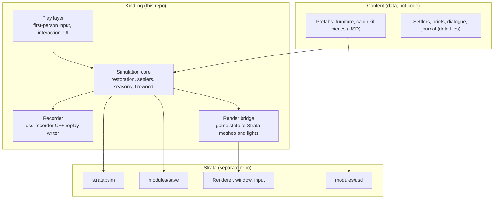

# Architecture

Kindling is a C++17 game on [Strata](https://github.com/Preponderous-Software/strata). This document
describes how it is built, and how it is meant to be built where the code does not exist yet.
Implemented (all of the MVP, milestones M1 to M7): the simulation core's world, movement and collision,
grime, tools, debris, repairs, furnishings, Ada's brief, firewood, the hearth, the game clock, Ada's
arrival, the mare, the reveal's keyframes, the step checklist and an autopilot that plays the whole MVP
(`src/sim/`), the replay export (`src/record/`), saves (`src/save/`), the room as tagged meshes
(`src/bridge/room.*`), the scene, grime textures and mesh picking on Strata (`src/bridge/scene.*`),
the HUD, the reveal and a play session with its input and autosave (`src/play/`), the desktop app
(`app/main.cpp`) and the browser build (`app/web_main.cpp`, `web/`, [docs/WEB.md](docs/WEB.md)).
Still plans: USD prefabs and data-driven content (Content) and model loading. The simulation core is described as designed; where
the MVP simplified it (one cabin, fixed fixtures rather than generic task lists), the code is the
reference.

## Layers



**The rule for the engine boundary:** game rules never go into Strata. Strata is a shared engine
for several projects and takes only generic features that a real consumer needs. Kindling may
propose engine additions (listed [below](#engine-additions)), but "a dirty wall needs three
scrubs" or "a settler's mood rises with room quality" stay here.

## Simulation core

The simulation is a deterministic, fixed-step model of the world, independent of rendering.

- **Fixed ticks.** `strata::sim::FixedStep` turns real elapsed time into whole ticks. The
  simulation never reads a clock.
- **Seeded randomness.** Every random number comes from `strata::sim::Rng` (PCG32), seeded per
  save.
- **Entities.** Settlers, items and fixtures live in `strata::sim::Registry`, with dense
  component arrays.
- **State fingerprint.** `strata::sim::StateHasher` (FNV-1a 64) over every saved field. It is
  the determinism check in tests and the state hash in replays.

As implemented, the MVP's simulation does not use `strata::sim`. The play session (`src/play/session.cpp`) turns elapsed time
into 30 ticks a second itself; `src/sim/rng.h` is Kindling's own PCG32, used only while building a
new world; the World is one struct with fixed fields (`src/sim/world.h`); and `fingerprint` in
`src/sim/world.cpp` is Kindling's own FNV-1a 64 over every saved field.

### Restoration model

A cabin is a set of **fixtures** (wall sections, floor planks, roof sections, windows, the
hearth, doors) and **items** (debris, furniture, decorations). Each fixture has:

- a **condition** state machine, for example plank `Rotten → Removed → New → Weathered`, window
  `Boarded → Open → Glazed → Curtained`;
- **surface layers** that hold grime and paint as low-resolution masks, cleaned or painted a patch
  at a time (implemented for grime: `src/sim/grime.*` keeps a grid of 0..255 values for the floor,
  each wall and the chimney face, 8 to 12 texels a metre; a tool cleans a disc round the aim point;
  the renderer shows each grid as a texture multiplying the surface's colour and re-uploads only
  the rectangle a tick changed, with `strata_update_texture_rgba8`);
- a list of **tasks** that move it forward, each with a tool, a duration and an effect.

The six steps of the core loop are views over this model, not separate systems: "Clear" is
whatever tasks remove debris, grime and snow; "Repair" is whatever tasks move fixtures out of
damaged states. A building is restored when every fixture reaches its target state.

### Settlers

Settlers are entities with traits, a mood value, a brief, and friendship. Mood is recomputed from
inputs (room quality, warmth, light, brief match, season, friendships) and never drives a failure.
Briefs are data: a list of conditions over the restoration model ("the sewing room is lit on two
sides", "a shelf holds the collection").

### Seasons and firewood

A calendar of 28-day seasons drives what tasks are available (no roofing in a blizzard), the
lighting (Strata's sun positioned by date), and firewood use per day. Firewood is counted in cords
and fractions of a cord.

## Rendering

The **render bridge** turns game state into Strata calls each frame:

- Cabin kit pieces and furniture are static meshes (`strata_add_mesh` /
  `strata_add_textured_mesh`) with per-mesh transforms.
- The hearth, candles and lanterns are point lights (up to 32; up to 4 cast shadows). The hearth
  flickers with the real clock in the renderer only (`Scene::animate`, `Scene::lights`), so the
  flicker never touches the simulation. Daylight indoors is soft unshadowed fills scaled by the
  sun's height: one through the door, one under each open section of the roof hole, and one at
  the window once its boards are off, standing in for bounced light.
- Flames and embers are unlit meshes.
- Creatures are rigid parts with per-mesh transforms, animated procedurally (no skeletons). The
  mare is three: her body, her head and neck (turning toward the player when near, dropping to eat
  after she is fed), and her tail (swishing faster the more content she is); she leans into the
  brush. Her coat is rebuilt as she comes clean.

The hearth prototype ([`prototypes/hearth-scene`](prototypes/README.md)) shows the lighting model
working: moonlight and a cold bounce in the ruin; a shadow-casting hearth light, a fill light and a
candle when restored.

## Engine additions

The MVP needs these from Strata. Each is generic enough to belong in the engine, and Kindling
is its first consumer.

| Addition | Why Kindling needs it | Notes |
|---|---|---|
| **Updatable surface masks** (texture sub-region updates) | Grime and paint that change patch by patch as the player cleans | Added in Strata ABI 1.8 (`strata_update_texture_rgba8`). |
| **Picking** (ray against meshes) | Knowing which wall, plank or item is under the crosshair | Added in Strata ABI 1.8 (`strata_raycast_meshes`, which returns the mesh and triangle hit). Kindling tags each mesh's triangle ranges with the target they belong to. |
| **Relative mouse mode** | First-person mouse look | Added in Strata ABI 1.8 (`strata_set_relative_mouse_mode`). |
| **Model loading** | Building the cabin kit and furniture in Blender | Either a small glTF loader in Kindling, or loading geometry through `modules/usd`. To be decided. |

Not needed for the MVP: skeletal animation, physics, a UI toolkit beyond Strata's text overlay.

## Saves

**For the MVP, Kindling writes its own save file** (`src/save/`), chosen by the owner because the
OpenUSD prebuilt Strata's save core needs could not be built and tested on the development
machine. It keeps the save core's guarantees:

- the World is written field by field, little-endian, after a magic, a format version and a length,
  and followed by a SHA-256 of the payload; the checksum is verified before a byte is read, and
  every read is bounds-checked, so a damaged or truncated save is refused, never half-loaded;
- a save goes to a temporary file and is renamed into place; the save it replaces is kept as the
  previous save, and loaded instead when the current one is damaged; a damaged save never
  replaces a good previous one;
- the game loads the slot on start (unless `--new`), saves with F5, reloads with F9, autosaves
  every two minutes and on quit. The slot defaults to `%APPDATA%\Kindling\default` on Windows and
  `~/.local/share/kindling/default` elsewhere (`--slot DIR` overrides).

The save holds the reveal's history, so the restoration plays back after a reload. Moving to
Strata's `modules/save`, with the world as a USD base layer, content packs as sublayers and a save
as a thin delta layer over them (steading's model), is the plan after the MVP.

## Content

- **Prefabs** (cabin kit pieces, furniture, decorations) are USD files under `content/`, each
  with a mesh and its gameplay data (placement rules, which briefs it satisfies).
- **People and words** (settlers, briefs, dialogue, journal entries) are data files under
  `content/`, so a personalised edition is a content pack.
- **CI checks content** with [usd-asset-gate](https://github.com/Preponderous-Software/usd-asset-gate):
  units, up axis, polygon budgets, naming and missing references, on every pull request that
  changes a USD file.

## Replays and the reveal

Every restoration is recorded as it happens with usd-recorder's dependency-free C++ writer
(`cpp/include/usd_recorder/replay_writer.hpp`) in the
[`usd-replay/1`](https://github.com/Preponderous-Software/usd-recorder/blob/1aae66d/docs/REPLAY.md)
layout:

| Replay part | What Kindling writes |
|---|---|
| Entity sets | the player, settlers, debris, window boards, furniture, firewood, flames |
| Field | the floor, one colour per 25 cm cell: dusty, clean, hole, snow, new plank, rug, firelight |
| Scene | static walls, chimney and mantel |
| Stats | step, debris left, floor holes, dusty cells, roof patched, items furnished, warmth |
| State hash | the simulation's own fingerprint at every sample |

As implemented: the World keeps a history of keyframes, a snapshot of what can be seen (grime at
half resolution, debris, repairs, furnishings, the hearth, Ada, the player) taken every ten seconds
of play and at every step change, and saved with the game.

1. **In game,** the reveal rebuilds a world from each keyframe in turn and draws it through the
   normal renderer from a slow camera drift across the room, about thirty seconds from ruin to Ada
   by the fire.
2. **Outside the game,** the same keyframes are written as a `usd-replay/1` file with
   usd-recorder's vendored writer (`third_party/usd_recorder`) when Ada is home, and
   [usd-web](https://github.com/Preponderous-Software/usd-web) turns it into a small web bundle that
   plays in a browser. The state hash per sample is a hash of the exported frame
   (`export-frame FNV-1a 64`), which the contract allows.

The restore prototype ([`prototypes/restore-replay`](prototypes/README.md)) writes such a replay
for the hearth room. It validates against the contract and plays in usd-web.

## Builds and platforms

- **Desktop first:** Windows (MSVC) and Linux. The MVP build needs no OpenUSD (its saves are
  Kindling's own, see [Saves](#saves)); Strata's prebuilt OpenUSD is planned for saves after the
  MVP and for content.
- **Browser:** the same game on Strata's WebGL 2 backend through Emscripten
  (`-DKINDLING_WEB=ON`, [docs/WEB.md](docs/WEB.md)), published to arcade with
  [arcade-deploy](https://github.com/Stephenson-Software/arcade-deploy). It writes Kindling's own
  save format to IndexedDB. Sign-in and cloud saves from
  [arcade-social](https://github.com/Stephenson-Software/arcade-social) are a later option.

## Playtesting by agents

`kindling --playtest-out DIR` (desktop or `--headless --autopilot`) writes what the player sees for
an AI playtest harness, so agents playing the real game headless can steer and check numbers
instead of guessing from screenshots. `src/playtest/probe.*` does it without the engine: the host
passes the screen, the frame rate and the HUD's words in a `HostView`, and the recorder only reads
the `World`, so a game with the flag plays exactly as one without it (`test_playtest` checks the
fingerprint).

- `DIR/state.json`, rewritten about twice a second (a temporary file renamed over it): `wallTimeMs`,
  `version`, `screen` (`WORLD`, or `REVEAL` during the timelapse), `fps`, `world`, `tps` (ticks a
  second; 30 is full speed), `seed`, `tick`, the `player` (`x`, `z`, `yawDeg` growing to the
  right, `pitchDeg`, tool, what is carried), the step as `objective`, the checklist, what the
  crosshair is on (`aim`), the step's numbers (`progress`), the settler, the hearth and the mare,
  and `nearest`: the door, wagon, hearth, window, chopping block, mare and the nearest debris, each
  with a distance in metres and a `bearing` in degrees from where the player faces, + to the right.
- `DIR/events.jsonl`, one object a line with `type`, `tick` and `wallTimeMs`: `world` (created or
  loaded), `screen` (from, to), `objective_completed` (one per step: Survey, Clear, Repair,
  Furnish, Kindle, Welcome), `status` (every message the game shows) and `save`.

The arrow keys look around as well as the mouse; a harness turns with them, because a key held for
a time turns by the same amount at any frame rate. A key tapped between two frames still counts for
one tick.

## Layout

```text
kindling/
  src/sim/        restoration model, settlers, seasons, firewood (no rendering, no USD)
  src/play/       the HUD, the reveal, a play session (input, autosave), shared by both apps
  src/bridge/     game state to Strata meshes and lights
  src/save/       the checksummed save file (USD layers through Strata's save core after the MVP)
  src/record/     the replay writer for the reveal
  src/playtest/   --playtest-out: state.json and events.jsonl for AI playtesters (no engine)
  app/            the desktop game (main.cpp) and the browser game (web_main.cpp)
  web/            the browser page's shell and its smoke test
  content/        prefabs (USD) and people, briefs and words (data; planned)
  tests/          determinism, golden images, save corruption, replay validation
  prototypes/     the M0 prototypes
  docs/           images, playtest notes
```

## Decisions still open

- **Model format:** glTF loaded by Kindling, or USD through `modules/usd`.
- **Settler and dialogue data format.**
- ~~How the in-game reveal plays the replay~~: from the save's history (decided in M5).
