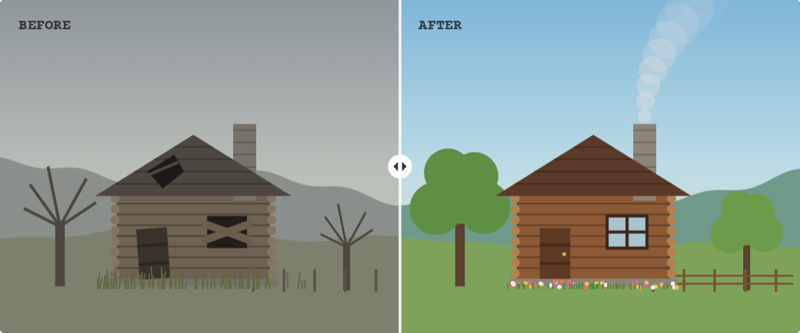
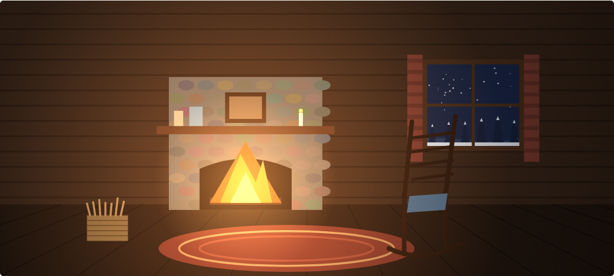
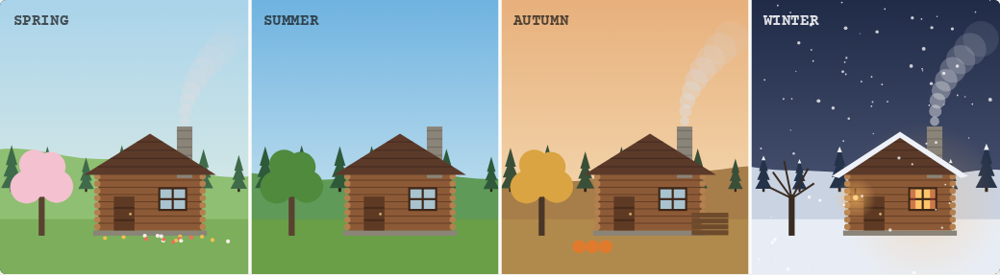
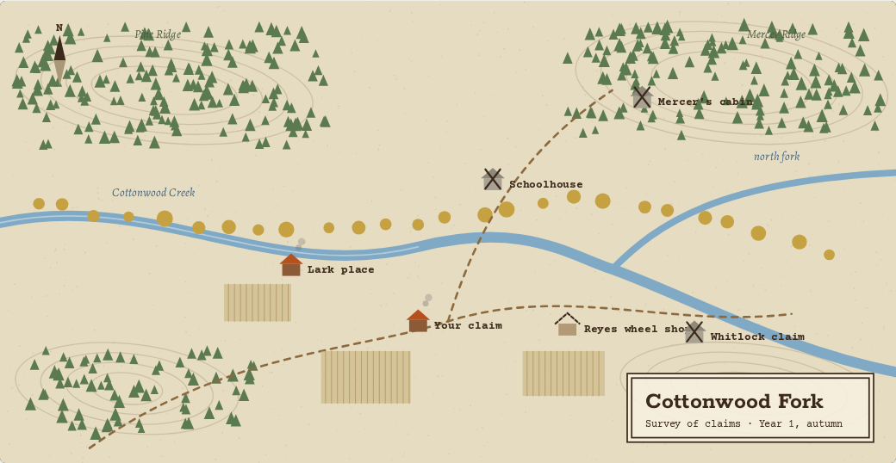

# Concept

## Pitch

You ride into Cottonwood Fork with a horse, a wagon and a deed to a claim nobody has lived on for
years. The cabins are empty, the fences are down and the creek is choked with deadfall. Over five
winters you restore the valley, welcome settlers into homes you rebuilt for them, and light the
first fire in every hearth.

Kindling is a cozy homestead game. It combines:

- the hands-on restoration of House Flipper (clean, repair, decorate, reveal);
- the frontier camp, the horse and the wandering of Red Dead Redemption 2;
- settlers with traits and moods from RimWorld;
- the seasons, friendships and small-town rhythm of Stardew Valley, Coral Island and Disney
  Dreamlight Valley.

It then removes the danger. Nobody starves, nothing attacks, and winter is a season for indoor
work and long evenings.

## Player fantasy

*Take something neglected and make it beautiful and lived-in, for people and creatures you have
come to care about.*

Every system serves that sentence. If a feature does not help the player restore, make a home, or
care for someone, it does not belong in Kindling.

## Pillars

| Pillar | In play | Drawn from |
|---|---|---|
| **Restore what's neglected** | Scrub, patch and rebuild cabins, fences and the creek | House Flipper, Coral Island's reef cleanup, Dreamlight Valley |
| **Make it home** | Furnish and decorate every room, including curtains and quilts | House Flipper, Hogwarts Legacy's Room of Requirement, tailoring sims |
| **Care for people** | Settlers with traits, moods, friendships and briefs for their homes | RimWorld, Stardew Valley, Coral Island |
| **A horse of your own** | Brush, feed and ride; the bond grows over the seasons | Red Dead Redemption 2, Hogwarts Legacy's beasts |
| **Seasons with purpose** | Plant, build, harvest and stack the woodpile before snow | Stardew Valley, RimWorld, Coral Island |
| **Wander the valley** | Forage, fish, find old letters and lost things off the trail | Red Dead Redemption 2, Hogwarts Legacy, Dreamlight Valley |

**No fail state.** Kindling never punishes the player. Pressure comes from wanting things to be
nice, not from losing them.

## The core loop: restoring one cabin

Every building goes through the same six steps.

1. **Survey.** Walk the cabin. Damage is marked: grime, rot, broken glass, missing shingles.
2. **Clear.** Haul out debris, cut back brush, sweep and scrub.
3. **Repair.** Replace boards, re-chink logs, re-shingle the roof, re-hang the door.
4. **Furnish.** Place furniture, rugs, curtains and quilts to fit the settler's brief.
5. **Kindle.** Lay kindling in the hearth and light the first fire. The cabin wakes up.
6. **Welcome.** The settler moves in, and the before/after timelapse plays.

Each action leaves a visible mark. Progress is never a number in a menu: it is a wall that was grey
and is now clean, a hole in the floor that is now a pale new plank.

### The kindling moment

Lighting the hearth is a short, hands-on ritual and gives the game its name. You stack kindling,
strike a match and shield it until the logs catch. The room changes as it happens: colour comes
into the walls, the window glows from outside, and the settler comments on what you made for them.
It is House Flipper's reveal, made into something the player does.

### The reveal

When a restoration finishes, the game plays back the whole job as a short timelapse, from the
first footstep in the ruin to the settler sitting by the fire. Every restoration is recorded as it
happens, so the reveal is the player's own work, not a canned animation. The replay can also be
watched outside the game (see [ARCHITECTURE.md](ARCHITECTURE.md#replays-and-the-reveal)).

## How the loops stack

| Scale | What happens |
|---|---|
| Minute to minute | Scrub, saw, nail, paint, place. Every action leaves a visible mark. |
| One day | Morning chores (horse, garden, woodpile), a project in the afternoon, and an evening at someone's hearth that raises your friendship. |
| One season | Seasons set the work. You can't re-shingle in a blizzard, and the woodpile has to be stacked before first frost. |
| Five winters | **Proving up.** Under the Homestead Act, settlers earned their deed by living on and improving the land for five years. After five winters the claim is yours and the valley goes on the territorial map. A celebration, and then you keep playing. |

## Seasons

Seasons run 28 days each.

| Season | Work | Arrivals and events | Woodpile |
|---|---|---|---|
| Spring | Plant the garden, clear the creek, repair fences after the thaw | New settlers arrive by wagon. Foals. | burning ½ cord |
| Summer | Big builds: roofs, barns, the schoolhouse. Forage berries. | Barn raising with the whole valley | cutting and drying |
| Autumn | Harvest, preserve, split and stack firewood | Harvest supper. The trapper comes down from the ridge. | stack 2 cords |
| Winter | Indoor work: furnish, sew quilts and curtains, carve | Long evenings, stories and the midwinter dance | burning 1½ cords |

### Firewood

Firewood is the one resource that carries through the year, measured in real frontier units:
kindling, then split stove wood, then a rick, then a cord (4 × 4 × 8 ft). A short woodpile never
hurts anyone. Settlers get chilly and grumpy, and the fix is a cozy day of splitting wood together.

## Settlers

Each settler has traits that shape their mood, a brief for their home, and a story told across
friendship levels. These four are working placeholders.

| Settler | Who they are | Their brief |
|---|---|---|
| **Ada Lark**, seamstress | Particular about light, quietly funny. Sews the valley's quilts and teaches you to make curtains and dresses. | A south-facing sewing room, a big table, and no dark corners. |
| **Tobias Reyes**, wheelwright | Loud, warm and always mid-project. Takes to your horse at once and builds the valley's wagons and tack. | A workshop bigger than the house, and a porch for evening tea. |
| **The Whitlocks**, a family of three | New to the territory, hopeful and a little out of their depth. Their daughter collects feathers, rocks and arrowheads. | A loft for the child, a shelf for her collection, and a kitchen that seats everyone. |
| **Silas Mercer**, trapper on the ridge | Was here when the valley emptied and doesn't trust newcomers. | Leave the old things where they are. Fix around them. |

Mercer's cabin is the last one restored, and it tells the player what happened to the valley.

**Moods** come from the home (light, warmth, room quality, whether the brief was met), from the
season (a full woodpile, a good harvest) and from friendships. A low mood shows in what a settler
says and does; it never causes harm or makes anyone leave.

## The valley

Cottonwood Fork is small enough to cross on horseback in a couple of minutes. Each claim on the map
is a restoration project, and the creek, the orchard and the ridge trail are outdoor ones.

## Personal content

Kindling is built so a player's own world can be written into it: the valley's name, the
settlers' names and stories, the pets, the journal entries that unlock as rooms are finished.
Settlers, places and journal text are data, not code, so a personalised edition is a content pack,
not a fork.

## Art direction

- **First-person 3D**, like House Flipper, inside cabins and out. There is no player character to
  model or animate, which is the biggest single saving in 3D art.
- **Low-poly with painterly light.** Shapes are chunky and readable. The warmth comes from
  lighting: lamplight, hearth glow, low autumn sun.
- **Colour is progress.** Ruins are grey and cool; restored places get their colour back. The
  palette tells the player how far along the valley is.
- **Creatures from rigid parts.** The horse and settlers are built from pieces that swing and bob
  (body, legs, head), which suits the style and needs no skeletal animation.
- **Audio follows the same idea:** a silent ruin, then birds, then a fire crackling and someone
  humming in the next room.

## What Kindling is not

- Not a survival game. No starvation, injury, raids or death.
- Not a builder with free-form construction everywhere. Restoration follows each building's
  original shape; decoration is where the player expresses themselves.
- Not a management sim. Settlers are people to know, not workers to assign.

## Open questions

- **Camera outdoors.** First person everywhere, or a pulled-back camera when riding?
- **The horse in the first slice.** Grooming only, or riding too? See [MVP.md](MVP.md).
- **Tailoring.** How deep the outfit-making loop goes, and whether it shares the furnishing brief
  system.
- **Name.** "Kindling" has not been checked against existing games yet.
