# Kindling

A cozy frontier homestead game: bring an abandoned valley back to life, one cabin, one neighbour
and one winter at a time. Kindling runs on [Strata](https://github.com/Preponderous-Software/strata),
a small C++ engine.

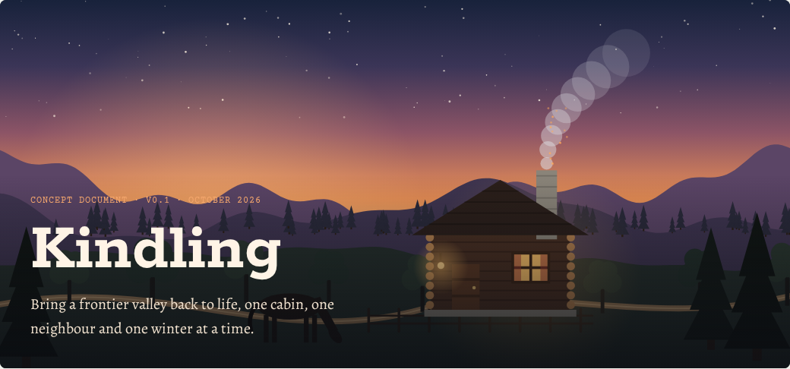

*Concept key art (a mood sketch drawn in code, not in-game art).*

**Status: the MVP is complete.** You can walk the ruined cabin and its yard in first person, survey
the damage, clear the place out (sweep and scrub the grime away patch by patch, haul the debris
out, saw the fallen rafter, shovel out the snow), repair it (pry up rotten boards and lay new
planks, patch the roof, pry the boards off the window, mend the rocking chair, set the table right),
furnish it from the wagon against Ada's brief, and kindle the hearth (split the firewood, shovel
out the ash, lay the fire and hold a match to it until it catches). The day runs from late morning
on 11 November into the first frost. Then Ada Lark walks up from her wagon, tells you what she
thinks of what you made for her, and sits down by the fire, and the whole restoration plays back
as a timelapse. Your mare waits in her stall to be fed and brushed. The game saves as you go. What
comes after the MVP is in [CONCEPT.md](CONCEPT.md).

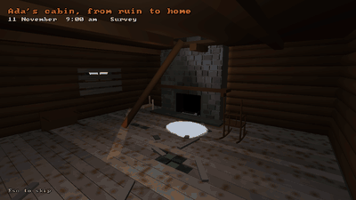

*The reveal at the end of a restoration, as the game plays it: here the autopilot's playthrough,
recorded and rendered headless by the game itself (`--headless --autopilot --reveal-frames`).*

| The ruin, at nine in the morning | Ada's home, at a quarter to eleven at night |
|---|---|
| 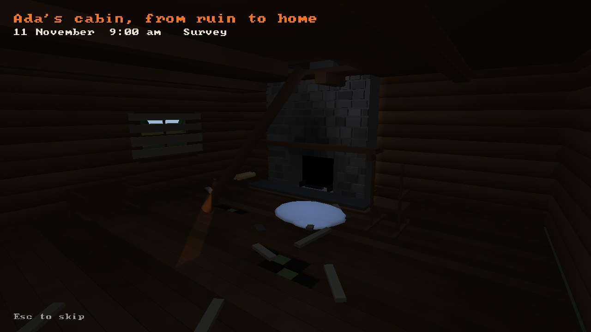 | 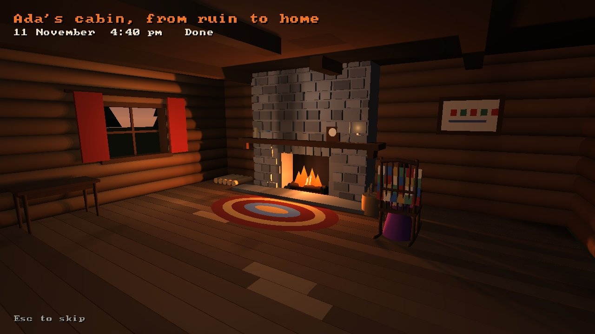 |

| Surveying the ruin | The mare, fed and brushed, on the night of the first frost |
|---|---|
| 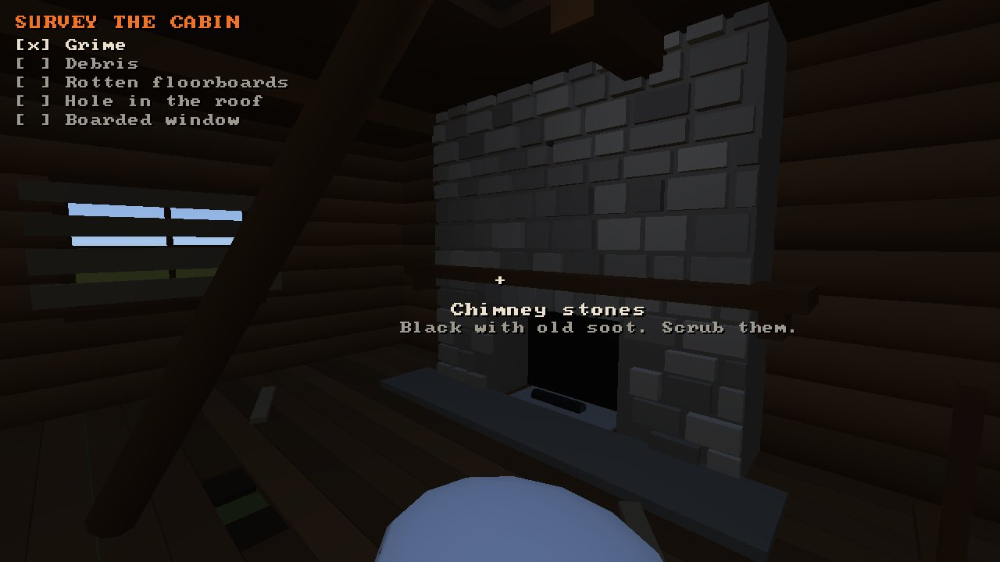 | 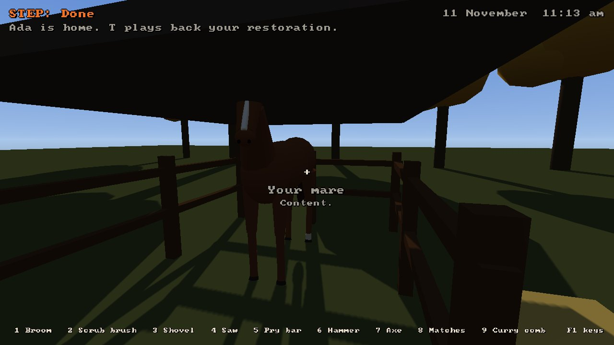 |

## Play it

**In your browser:** [kindling.play.danielstephenson.dev](https://kindling.play.danielstephenson.dev),
on a computer or a phone. It saves in that browser. [docs/WEB.md](docs/WEB.md) says how the browser
build differs.

**On your computer:** Kindling builds with CMake and a C++17 compiler. Strata, and the SDL3 it uses, are fetched and
built along with it (at the commit `KINDLING_STRATA_REF` in `CMakeLists.txt` pins).

```sh
cmake -S . -B build
cmake --build build --config Release
./build/kindling            # Windows: build\Release\kindling.exe
ctest --test-dir build -C Release
```

On Windows, [`tools/play-kindling.bat`](tools/play-kindling.bat) does all of this: it installs
CMake and the C++ build tools with winget if they are missing, clones or updates Kindling, builds
it, and plays, saving in `%USERPROFILE%\kindling-save`.

On Linux, SDL3 needs the X11 development packages (`libx11-dev libxext-dev libxcursor-dev libxi-dev
libxfixes-dev libxrandr-dev libxss-dev`). `cmake -DKINDLING_WITH_STRATA=OFF` builds only the
simulation and its tests, with no engine.

| Input | Action |
|---|---|
| Mouse | look |
| W A S D | walk |
| Shift | hurry |
| 1 to 9 | take a tool: broom, scrub brush, shovel, saw, pry bar, hammer, axe, matches, curry comb (\` for bare hands) |
| Left mouse (hold) | work with the tool on what the crosshair is on; with a plank or shingles in hand, work them in |
| E | pick up or put down (debris put down outdoors is hauled out; furnishings go where they belong; E at the wagon puts a thing back) |
| R | turn what you carry |
| L | light or put out your lantern |
| T | play the restoration back again, once Ada is home |
| F5 / F9 | save now / reload the last save (it also autosaves every two minutes, and on quit) |
| F1 | show or hide the help |
| F12 | screenshot |
| Esc | free the mouse (Esc again quits) |

| Swept | Unboarded |
|---|---|
| 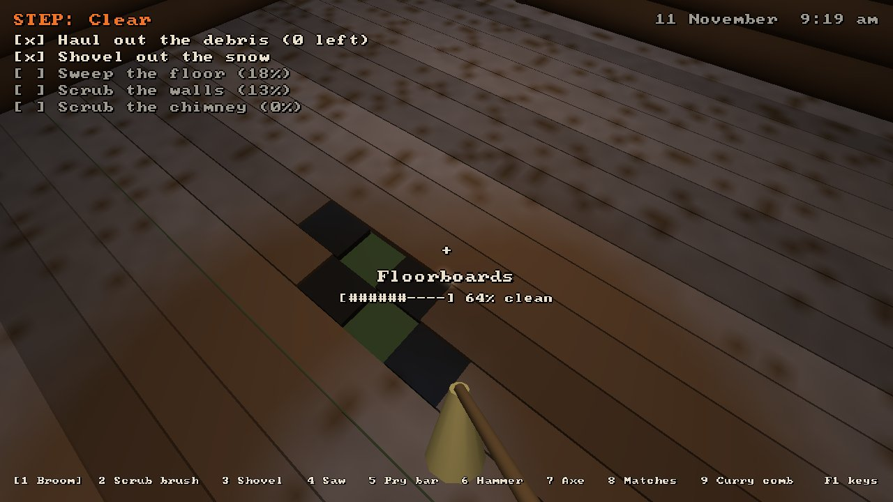 | 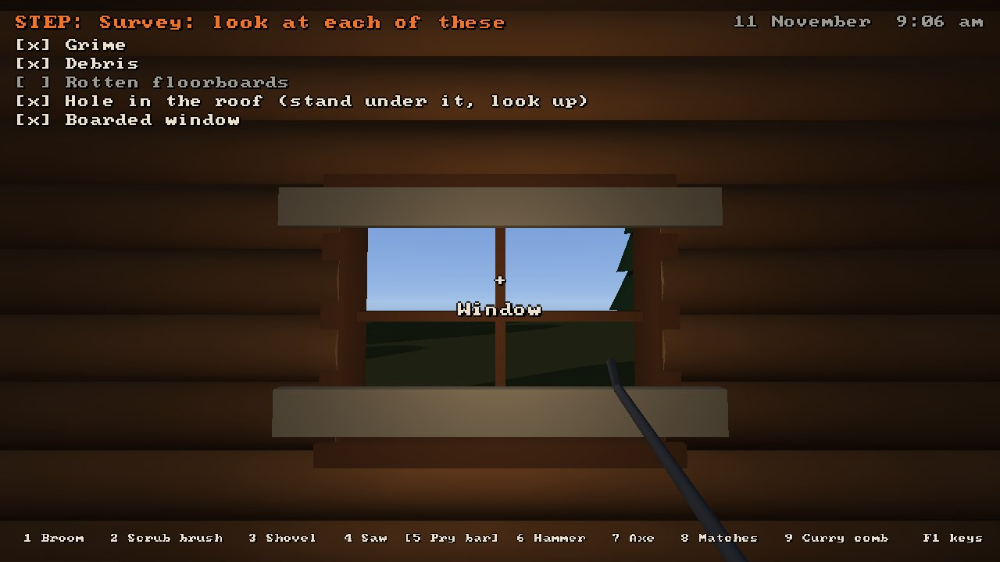 |

`kindling --headless --tour --frames DIR` walks a scripted path into the cabin, sweeps and scrubs a
little, without a window, and writes a screenshot at each stop. `kindling --autopilot` hands the
controls to an autopilot that plays the whole restoration (add `--speed N` to watch it fast);
`kindling --headless --autopilot --frames DIR --reveal-frames DIR --replay run.usda` does it
without a window, writing frames, the reveal and the replay. CI runs both.

## The idea

You arrive in Cottonwood Fork with a horse, a wagon and a deed to a claim nobody has lived on for
years. You restore each cabin from ruin to home: survey, clear, repair, furnish, then **kindle**,
lighting the first fire in its hearth. Then a settler moves in. Over five winters the valley comes
back to life.

There is no combat and no way to lose. Winter makes settlers chilly and grumpy, never hungry or
hurt. The game is about making places beautiful and lived-in for people you come to care about.

## In the engine

The same room before and after restoration, rendered headless by Strata 0.3.0. The only light in
the first image is moonlight; the second adds the hearth.

| Before | After |
|---|---|
| 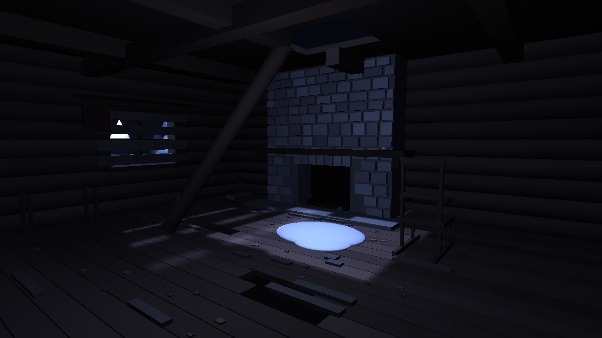 | 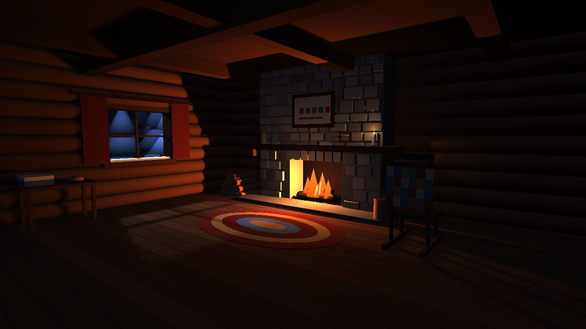 |

The whole restoration of that room, recorded tick by tick as a
[`usd-replay/1`](https://github.com/Preponderous-Software/usd-recorder/blob/1aae66d/docs/REPLAY.md)
replay and played in [usd-web](https://github.com/Preponderous-Software/usd-web)'s browser player:

| Start (tick 0) | End (tick 3,134) |
|---|---|
| 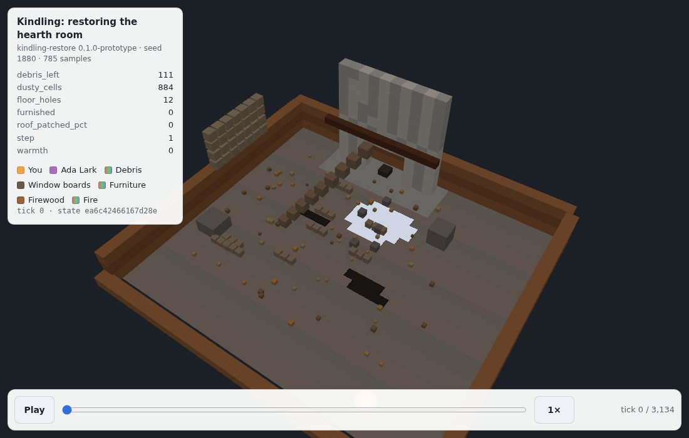 | 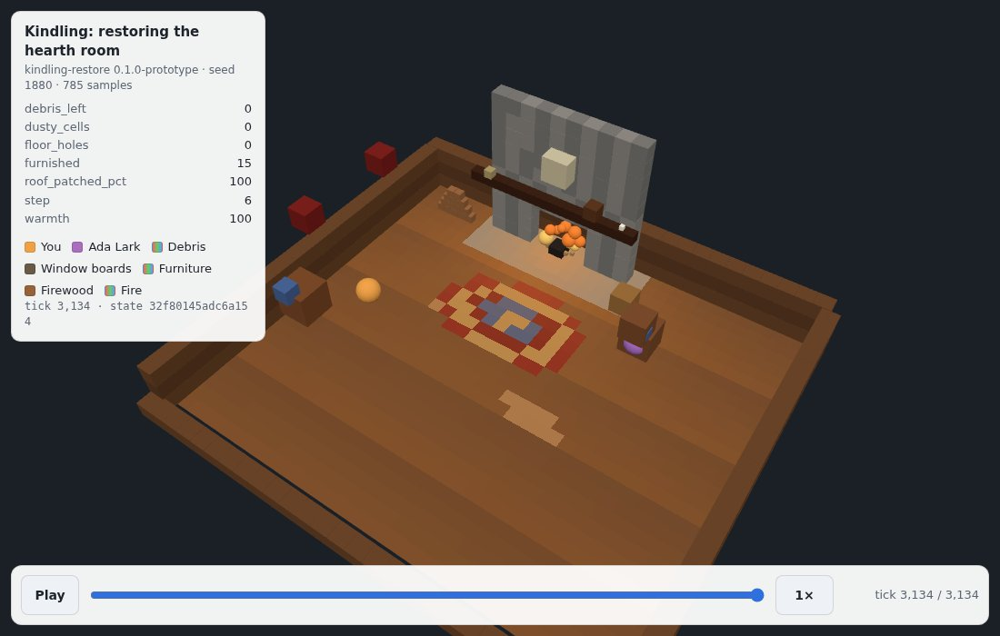 |

Both prototypes are in [`prototypes/`](prototypes/README.md), with the commands that produce these
images.

## Documents

| Document | What it covers |
|---|---|
| [CONCEPT.md](CONCEPT.md) | The game: player fantasy, pillars, the core loop, seasons, settlers, the valley, art direction |
| [MVP.md](MVP.md) | The first playable slice: what is in, what is out, milestones and how each is checked |
| [ARCHITECTURE.md](ARCHITECTURE.md) | How it is built: the engine boundary, game modules, saves, content, replays, the browser build |

## Built on

- [Strata](https://github.com/Preponderous-Software/strata): rendering, the window and input,
  texture updates and mesh picking. The MVP does not use its checksummed saves (`modules/save`),
  OpenUSD (`modules/usd`) or deterministic simulation pieces (`strata::sim`): Kindling has its own
  save file and simulation core (see [ARCHITECTURE.md](ARCHITECTURE.md#saves)).
- [usd-recorder](https://github.com/Preponderous-Software/usd-recorder): its C++ replay writer
  records each restoration for the reveal timelapse.
- [usd-web](https://github.com/Preponderous-Software/usd-web): plays those replays in a browser.

[steading](https://github.com/Preponderous-Software/steading), a colony sim on the same engine, is
the closest sibling: Kindling borrows its patterns for settlers, seasons and saves.

## License

[MIT](LICENSE).
